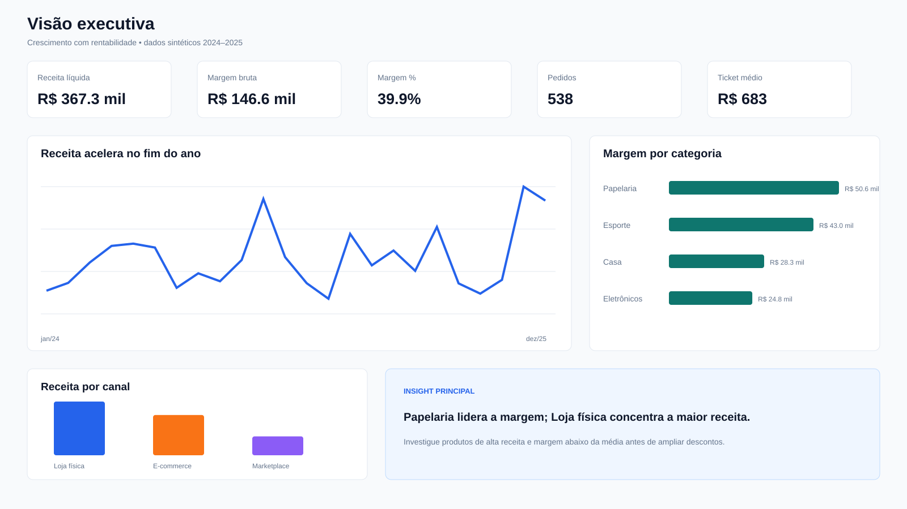

# Retail Analytics Platform

Projeto de portfólio end-to-end para demonstrar competências de Analista de Dados, BI e Especialista em Dados.


## Destaques para recrutadores

- Pipeline reproduzível com dados sintéticos, carga incremental e idempotência por hash.
- Arquitetura PostgreSQL em camadas `raw`, `staging` e `marts`.
- Modelo dimensional com SCD Tipo 2, duas tabelas fato e reconciliação financeira.
- Qualidade auditável: 5 de 5 anomalias conhecidas detectadas e impacto em cascata rastreado.
- Power BI: modelo semântico, medidas DAX, RLS, tema acessível e quatro páginas especificadas.
- Engenharia de produção: Docker, CI com PostgreSQL real, CodeQL, Dependabot, retry, observabilidade e runbook.



## Objetivo

Construir uma plataforma analítica de varejo capaz de integrar vendas, clientes, produtos, lojas e estoque, transformar os dados em um modelo dimensional confiável e disponibilizar indicadores para decisões comerciais e operacionais.

O projeto responderá perguntas como:

- Quais produtos, lojas e regiões geram mais receita e margem?
- Onde existem quedas anormais de desempenho?
- Quais produtos apresentam risco de ruptura ou excesso de estoque?
- Como retenção, recorrência e ticket médio variam por segmento?
- Quais ações têm maior potencial de impacto financeiro?

## Competências demonstradas

- SQL analítico e modelagem dimensional
- Python para ingestão, validação e análise
- ETL/ELT e automação de pipelines
- Power BI, DAX e storytelling com dados
- Qualidade, documentação e governança de dados
- Docker, testes, GitHub Actions e observabilidade
- Tradução de problemas de negócio em soluções técnicas

## Arquitetura planejada

```text
Arquivos/API
    |
    v
Ingestão Python
    |
    v
PostgreSQL: raw -> staging -> marts
    |                       |
    |                       +--> testes de qualidade
    v
Modelo dimensional
    |
    v
Power BI + relatório executivo
```

## Roadmap

| Fase | Entrega | Status |
|---|---|---|
| 1 | Escopo, arquitetura, KPIs e estrutura do projeto | Concluída |
| 2 | Geração e documentação dos dados fictícios | Concluída |
| 3 | Banco PostgreSQL e camadas raw/staging | Concluída* |
| 4 | Modelo dimensional e SQL analítico | Concluída* |
| 5 | Pipeline Python e testes de qualidade | Concluída |
| 6 | Dashboard Power BI e medidas DAX | Concluída* |
| 7 | Docker, CI/CD, observabilidade e documentação final | Concluída |
| 8 | Demonstração, revisão e publicação no GitHub | Concluída |

## Indicadores principais

- Receita bruta e líquida
- Margem bruta e percentual de margem
- Quantidade de pedidos e itens vendidos
- Ticket médio
- Crescimento mensal e anual
- Clientes ativos, novos e recorrentes
- Taxa de recompra
- Giro, cobertura e risco de ruptura de estoque
- Desempenho por produto, categoria, loja, região e canal

As definições completas estão em [docs/kpi_dictionary.md](docs/kpi_dictionary.md).

## Estrutura prevista

```text
retail-analytics/
|-- .github/workflows/
|-- dashboards/
|-- data/sample/
|-- docker/
|-- docs/
|-- notebooks/
|-- sql/
|-- src/
|-- tests/
|-- .env.example
|-- docker-compose.yml
|-- pyproject.toml
`-- README.md
```

## Dados e privacidade

O projeto utilizará exclusivamente dados sintéticos. Nenhum dado pessoal real será versionado. Clientes receberão identificadores fictícios, e campos sensíveis serão limitados ao necessário para demonstrar técnicas de governança e mascaramento.

### Gerar a base

O gerador usa apenas a biblioteca padrão do Python e produz os mesmos dados quando recebe a mesma semente:

```bash
python -m src.retail_data.generate --output data/sample --seed 42
```

Por padrão, ele inclui anomalias documentadas para que as próximas fases demonstrem validação e quarentena. Para gerar dados totalmente limpos:

```bash
python -m src.retail_data.generate --output data/sample --seed 42 --clean
```

Executar testes:

```bash
python -m unittest discover -s tests -v
```

O esquema completo está em [docs/data_dictionary.md](docs/data_dictionary.md), e as anomalias intencionais estão em [docs/quality_scenarios.md](docs/quality_scenarios.md).

### Subir o banco e carregar os dados

```bash
cp .env.example .env
docker compose up -d
pip install -e .
python -m src.retail_data.ingest --data-dir data/sample
```

Validar arquivos sem conexão com o PostgreSQL:

```bash
python -m src.retail_data.ingest --data-dir data/sample --dry-run
```

O carregador é incremental e idempotente: o hash do conteúdo impede que a mesma linha da mesma fonte seja inserida novamente. Todas as execuções são auditadas e linhas inválidas são registradas em `raw.rejections`.

\* A infraestrutura está pronta, mas a integração não foi executada neste ambiente porque o Docker não está instalado.

### Construir os marts

Após carregar staging, execute:

```bash
psql -f sql/marts/001_dimensions_and_facts.sql
psql -f sql/marts/002_load_marts.sql
psql -f sql/marts/003_semantic_views.sql
```

Em seguida, as consultas de portfólio ficam disponíveis em `sql/analytics/`. O desenho e a granularidade estão documentados em [docs/dimensional_model.md](docs/dimensional_model.md).

### Relatório de qualidade

```bash
python -m src.retail_data.quality \
  --data-dir data/sample \
  --json-output data/quality_report.json \
  --markdown-output docs/generated_quality_report.md
```

O relatório separa falhas originais de rejeições propagadas por dependência, calcula qualidade por fonte e verifica se todas as anomalias intencionais foram detectadas. A ingestão também suporta retry exponencial para falhas transitórias:

```bash
python -m src.retail_data.ingest --data-dir data/sample --max-attempts 3
```

### Power BI

Os artefatos para construção do relatório estão em `powerbi/`: tema, medidas DAX, modelo semântico, regras de RLS e especificação visual. Uma prévia da página executiva está disponível em [docs/dashboard_preview.svg](docs/dashboard_preview.svg).

\* O `.pbix` depende do Power BI Desktop e será materializado quando a ferramenta estiver disponível.

### Verificação completa do banco

Com PostgreSQL disponível:

```bash
python -m src.retail_data.bootstrap
python -m src.retail_data.ingest --data-dir data/sample
python -m src.retail_data.bootstrap --marts
python -m src.retail_data.integration_check
```

O workflow de CI repete esse fluxo com um PostgreSQL temporário, executa os testes e publica os relatórios gerados como artefatos.

## Licença

Distribuído sob a licença MIT. Consulte [LICENSE](LICENSE).
